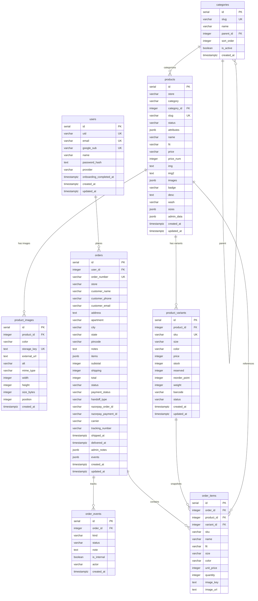

# Database Schema V2 & Storage Architecture

This document defines the Schema V2 architecture, storage refactor, migration reconciliation, operational runbook, and baseline discovery for TEESGARAGE.

---

## 1. Phase 0 Discovery & Baseline

### 1.1 Baseline Validation Results
- **TypeScript Typecheck**:
  `npm run typecheck` across all packages passed cleanly (`@jeans-store/shared`, `@jeans-store/validators`, `@jeans-store/db`).
- **Builds**:
  `apps/api`: `npm run build` (`tsc`) compiled cleanly to `dist/`.
- **Unit & Integration Tests**:
  `apps/api`: `npm run test` ran 23 tests across 4 test suites with 0 failures (`catalog-and-orders.test.ts`, `sku-generation.test.ts`, `schema-sync.test.ts`).
- **Smoke Tests**:
  `apps/api`: `npm run smoke` verified 17/17 endpoints and operations including product listing, filtering, order placement, auth, navigation, and stock management.
- **Linter**:
  `npm run lint` across monorepo passed cleanly.

### 1.2 Migration-State Reconciliation Analysis
- **Migration Folders Discrepancy**:
  - `packages/db/drizzle`: Contained `0000_unknown_firebird.sql` and `0001_admin_shipping.sql` with `_journal.json` tracking both indices 0 and 1.
  - `apps/api/drizzle`: Contained only `0000_unknown_firebird.sql` with `_journal.json` index 0. `apps/api/scripts/migrate.ts` was pointing to `apps/api/drizzle`.
  - **Resolution**: `0001_admin_shipping.sql` and its journal entry were mirrored to `apps/api/drizzle`, and an automated regression test `apps/api/tests/schema-sync.test.ts` was introduced to prevent future drift.
- **How Changes Were Applied Historically**:
  - `0000_unknown_firebird.sql` created initial tables: `products`, `orders`, `users`, `navigation_items`.
  - `product_variants` was added later via `apps/api/scripts/migrate-skus.ts` with custom SQL (`CREATE TABLE IF NOT EXISTS product_variants (...)`). It was never recorded in a Drizzle migration file.
  - `0001_admin_shipping.sql` in `packages/db/drizzle` added `shipping_settings`, `admin_state`, and columns `products.admin_data`, `products.images`, and `orders.payment_status`.
  - Depending on whether production was updated via `drizzle-kit push`, manual SQL, or `migrate.ts`, the `drizzle.__drizzle_migrations` table on Neon may only record `0000_unknown_firebird`.
- **Safety of Re-running Migration 0001**:
  - `0001_admin_shipping.sql` uses `ADD COLUMN IF NOT EXISTS` and `CREATE TABLE IF NOT EXISTS`.
  - **CAUTION**: Lines 7-9 run an `UPDATE "products"` that marks any product whose category is not in `('stripes', 'fullsleeve', 'drsleeve', 'printed-tees', 'ringer-tees', 'henley', 'trackpants', 'sweatpants')` as `status: 'Archived'` inside `admin_data`.
  - Lines 21-27 run an `UPDATE "orders"` resetting `payment_status` and `status`.

### 1.3 Inventory of Real Values in Use
1. **`admin_data` JSONB Keys & Statuses**:
   - Keys Written: `slug`, `sku`, `brand`, `categoryId`, `collectionId`, `collection`, `gender`, `rise`, `material`, `pattern`, `inseam`, `compareAtPrice`, `costPrice`, `taxRate`, `status`, `featured`, `weightGrams`, `legacyCategory`.
   - Keys Read: All of the above, plus `views`, `wishlists`.
   - `status` values in production: `'Active'`, `'Draft'`, `'Archived'`.
2. **Order `status` and `payment_status` Values**:
   - `status`: `'Pending'`, `'Confirmed'`, `'Processing'`, `'Shipped'`, `'Delivered'`, `'Cancelled'`.
   - `payment_status`: `'Pending'`, `'Paid'`, `'Failed'`, `'Refunded'`.
3. **`handoff_type` Values**:
   - `'whatsapp'`, `'email'`, `'razorpay'`, `'cod'`.
4. **Razorpay ID Persistence**:
   - The TypeScript `Order` interface has fields `razorpayOrderId` and `razorpayPaymentId`.
   - In Database Schema v1, there were **no dedicated columns** for Razorpay IDs in the `orders` table. They were stored by formatting text into the `notes` column (e.g., `Razorpay Payment ID: pay_... | Order ID: order_...`).
5. **Money Unit of `price_num`**:
   - `price_num` in DB and `Product` models is in **Indian Rupees (INR integer)**, e.g. `1199` for ₹1,199.
   - It is only multiplied by 100 to convert to paise when making calls to the Razorpay checkout API.

### 1.4 Codebase Discrepancies Noted
1. **Dual Schema Architecture & Monorepo Imports**:
   - Both `packages/db/src/schema.ts` and `apps/api/src/db/schema.ts` exist.
   - `apps/api/tsconfig.json` has `rootDir: "src"`. If `apps/api/src/db/schema.ts` attempts to re-export from `@jeans-store/db`, `tsc` fails build validation because `@jeans-store/db` exports uncompiled TypeScript source (`src/index.ts`), and the multi-stage Dockerfile executes `node dist/index.js` in production without tsx.
   - Decision: Maintain schema parity test (`apps/api/tests/schema-sync.test.ts`) that runs on every test/build.
2. **`smoke.ts` Authentication & Apparel Sizes**:
   - `smoke.ts` originally sent `x-api-key: local_dev_admin_key`, which was rejected (401) by `verifyAdminAuth` (which requires signed JWT session Bearer tokens).
   - `smoke.ts` ordered size `'32'`, which was rejected for item 1 after the catalog pivot to t-shirts. Updated `smoke.ts` to log in via `/api/admin/auth/login` and order size `'M'`.

---

## 2. Neon Production Read-Only Checks

Run these read-only SQL queries against Neon to inspect live schema state before applying Phase 1/Phase 2 migrations:

```sql
-- 1. Check migrations tracking history
SELECT id, hash, created_at FROM drizzle.__drizzle_migrations ORDER BY created_at;

-- 2. Check existing public tables
SELECT table_name 
FROM information_schema.tables 
WHERE table_schema = 'public' 
ORDER BY table_name;

-- 3. Check products table columns
SELECT column_name, data_type, is_nullable, column_default 
FROM information_schema.columns 
WHERE table_name = 'products' 
  AND column_name IN ('admin_data', 'images', 'category_id', 'slug', 'status', 'attributes')
ORDER BY column_name;

-- 4. Check orders table columns
SELECT column_name, data_type, is_nullable, column_default 
FROM information_schema.columns 
WHERE table_name = 'orders' 
  AND column_name IN ('payment_status', 'carrier', 'tracking_number', 'admin_notes', 'events', 'user_id', 'razorpay_order_id', 'razorpay_payment_id')
ORDER BY column_name;

-- 5. Distinct categories and statuses in products
SELECT category, count(*) FROM products GROUP BY category;
SELECT admin_data->>'status' AS admin_status, count(*) FROM products GROUP BY admin_data->>'status';

-- 6. Distinct order status and payment status values
SELECT status, count(*) FROM orders GROUP BY status;
SELECT payment_status, count(*) FROM orders GROUP BY payment_status;
SELECT handoff_type, count(*) FROM orders GROUP BY handoff_type;
```

---

## 3. Architecture & Target Schema (V2)

### 3.1 Entity Relationship Diagram



---

## 4. Before / After Table Summary

| Table | V1 (Current) | V2 (Target) | Notes |
| :--- | :--- | :--- | :--- |
| `categories` | None (hardcoded enum) | Normalized table with parent hierarchy and sort order | Seeded from `CATEGORIES` const + `jeans` |
| `product_images` | None (`products.img`, `img2`, `images` URLs) | Normalized rows with `storage_key` / `external_url` | Ordered by `position` (0=main, 1=hover) |
| `products` | Category as varchar; status buried in `admin_data`; attributes dropped | Real `category_id`, unique `slug`, indexed `status`, `attributes` JSONB | Dual-writes to legacy columns until Phase 4 |
| `product_variants`| No check constraints | Added CHECKs: `stock >= 0`, `reserved >= 0`, `price >= 0`, valid statuses | Unchanged columns |
| `users` | Basic IAM | Added `google_sub`, `onboarding_completed_at`, unique lowercase email | Supports Google SSO sub matching |
| `orders` | No `user_id`, JSONB arrays for `items`/`events` | Added `user_id`, `razorpay_order_id`, `razorpay_payment_id`, status CHECKs | Dual-writes items & events |
| `order_items` | None (JSONB in `orders.items`) | Normalized table with variant/product FKs & immutable image snapshot | Resolves SKU, price, size, image |
| `order_events` | None (JSONB in `orders.events` & `admin_notes`) | Append-only event stream with actor, timestamp, note | Single INSERTs replace read-modify-write |

---

## 5. Phase 1: Key-Based Image Storage Architecture

### 5.1 Storage Service & Drivers
Located at `apps/api/src/services/storage.ts`:
- **`ObjectStorage` interface**: Defines `put(key, bytes, contentType)`, `delete(key)`, `list(prefix)`, `getUrl(key)`.
- **`LocalStorageDriver`**: Used in local development and offline environments when no cloud bucket is configured. Writes files to `apps/api/.local-uploads/` (gitignored) and serves them via Express static middleware at `/assets`. Replaces the insecure base64 `data:` URI fallback.
- **`GcsStorageDriver`**: Production Google Cloud Storage driver utilizing `@google-cloud/storage`. Uses bucket `GCS_PRODUCT_IMAGES_BUCKET` with `Cache-Control: public, max-age=31536000, immutable`.
- **`S3StorageDriver`**: S3-compatible driver supporting AWS S3, Cloudflare R2, MinIO, or Google Cloud Storage interoperability endpoint (HMAC keys) via `@aws-sdk/client-s3`.

### 5.2 Bucket Configuration Requirements
1. **Public Read Permissions**:
   - The bucket path prefix `products/*` must be readable publicly via HTTP GET.
   - Alternatively, a CDN (e.g. Cloudflare, Cloud CDN) or custom domain must sit in front of the bucket and map to `ASSET_BASE_URL`.
2. **CORS Configuration**:
   - Because upload requests currently flow through the API server (`POST /api/uploads/products`), browser CORS on the storage bucket is **not** currently required.
   - If direct-to-bucket pre-signed browser uploads are added in the future, set CORS on the bucket:
     ```json
     [
       {
         "origin": ["https://teesgarage.in", "https://admin.teesgarage.in"],
         "method": ["PUT", "POST"],
         "responseHeader": ["Content-Type", "ETag"],
         "maxAgeSeconds": 3600
       }
     ]
     ```

### 5.3 URL Resolution & Helpers
Located in `@jeans-store/shared`:
- **`assetUrl(key)`**: Constructs the full public URL from `ASSET_BASE_URL` (or fallback GCS bucket URL).
- **`keyFromUrl(url)`**: Extracts the relative storage key (e.g., `products/<uuid>.webp`) if the URL starts with `ASSET_BASE_URL` or legacy GCS prefixes (`https://storage.googleapis.com/<bucket>/`), returning `null` for third-party or Unsplash URLs.

### 5.4 Dual-Write and Single-Query Reads
- **Write Path**: In `ProductStore.create()` and `update()`, images are normalized. Storage keys or external URLs are dual-written to `product_images` (sorted by `position`) and legacy columns `img`, `img2`, `images`. Base64 `data:` URIs and insecure non-HTTPS links are rejected.
- **Read Path**: Single SQL query loads all active images for listed products (`SELECT * FROM product_images`). `toProduct()` maps `position 0` -> `img`, `position 1` -> `img2` (with fallback to `img` if single image), and full gallery -> `images`. If no rows exist in `product_images` yet, it safely falls back to legacy columns.

### 5.5 Maintenance & Operations Scripts
- **Backfill**: `npx tsx scripts/backfill-product-images.ts` (Dry-run by default; pass `--apply` to write rows). Skips products already possessing `product_images` rows.
- **Orphan Prune**: `npx tsx scripts/prune-orphan-images.ts` (Dry-run by default; pass `--apply` to delete). Never deletes inline during product edits or deletions (safeguarding order history snapshots). Deletes only storage objects under `products/` that are older than 24 hours and referenced by neither `product_images.storage_key` nor `order_items.image_key`.

---

## 6. Phase 2: Catalog Normalization Architecture & Ops

### 6.1 Categories Table & Seeding
- **Table**: `categories` with `id`, `slug`, `name`, `parent_id` (self-referential FK on delete set null), `sort_order`, `is_active`, `created_at` (timestamptz).
- **Seeded Categories (13)**: `stripes`, `fullsleeve`, `drsleeve`, `printed-tees`, `ringer-tees`, `henley`, `trackpants`, `sweatpants`, `t-shirts`, `shirts`, `hoodies`, `accessories`, and `jeans`.
- **Validation**: `POST /api/products` and `PUT /api/products/:id` validate `category` against the `categories` table (or in-memory catalog). Unknown categories are rejected with HTTP 400 and a descriptive error message listing valid category slugs.
- **Endpoint**: `GET /api/categories` returns active category slugs.

### 6.2 Products Additive Columns & Attributes
- **Columns**:
  - `category_id`: Foreign key referencing `categories.id` (ON DELETE RESTRICT).
  - `slug`: Unique, kebab-case identifier (max 160 chars) automatically generated from product name and de-duplicated with numeric suffixes (e.g. `classic-stripes-tee`, `classic-stripes-tee-2`).
  - `status`: Indexed varchar(20) constrained to `draft`, `active`, `archived`. Default `active`.
  - `attributes`: JSONB column storing descriptive spec attributes (`fabric`, `material`, `sleeveLength`, `neckType`, `pattern`, `printStyle`, `trimColor`, `buttons`, `waistSize`, `length`, `closure`, `pockets`, `use`, `legStyle`, `rise`, `collection`).
  - `created_at` / `updated_at`: Converted to `timestamp with time zone` (`timestamptz`) using UTC. Neon PostgreSQL defaults to UTC session timezone.
- **Backward Compatibility**:
  - `toProduct()` preserves all legacy fields: `img`, `img2`, `images`, `price`, `priceNum`, `category` (slug string), and `adminData.status`.
  - `adminData.status` is synchronized directly from the `status` column (`'Active'`, `'Draft'`, `'Archived'`).
  - Descriptive attributes stored in `attributes` JSONB are automatically unpacked as top-level properties on the returned product.

### 6.3 Product Variants Constraints
- Constraints added:
  - `stock >= 0`
  - `reserved >= 0`
  - `price >= 0`
  - `status IN ('Active', 'Inactive')`

### 6.4 SQL Push-Down Filtering in `ProductStore.list()`
- Replaced the previous full-table in-memory filter with SQL `WHERE` push-down queries:
  - `store`: `eq(products.store, store)`
  - `category`: `ilike(products.category, category)`
  - `fit`: `ilike(products.fit, fit)`
  - `status`: Storefront queries automatically filter `status = 'active'`, excluding `draft` and `archived` products. Admin requests pass `includeAllStatuses: true`.
  - `q`: Search across `name`, `desc`, and `badge` using `ilike`.
  - `sku`: Variant join looking up product IDs matching variant SKUs before filtering products.
- Related variants and images are queried in single batch queries using `inArray(productId, productIds)`, eliminating N+1 queries.

### 6.5 Operations Runbook for Phase 2 Migrations (Neon)
When ready to apply Phase 2 migrations to Neon:
1. Verify database timezone is UTC:
   ```sql
   SHOW timezone; -- Expected: 'UTC'
   ```
2. Apply migration `0002_product_images.sql`:
   ```bash
   # Can be applied via Drizzle migrator or psql:
   psql "$DATABASE_URL" -f apps/api/drizzle/0002_product_images.sql
   ```
3. Apply migration `0003_catalog_normalization.sql`:
   ```bash
   psql "$DATABASE_URL" -f apps/api/drizzle/0003_catalog_normalization.sql
   ```
4. Verify backfilled columns and categories:
   ```sql
   SELECT count(*) FROM categories; -- Expected: 13
   SELECT count(*) FROM products WHERE category_id IS NULL; -- Expected: 0 (or only legacy unmapped categories)
   SELECT count(*) FROM products WHERE slug IS NULL; -- Expected: 0
   SELECT status, count(*) FROM products GROUP BY status;
   ```

---

## 7. Phase 3: Users & Orders Normalization Architecture & Ops

### 7.1 Users Table Updates
- **Columns Added**:
  - `google_sub`: varchar(255) unique nullable column storing Google OAuth subject ID.
  - `onboarding_completed_at`: `timestamp with time zone` nullable timestamp. Null indicates onboarding has not yet been completed.
  - `created_at` / `updated_at`: Converted to `timestamp with time zone` (`timestamptz`).
- **Indexes Added**:
  - `users_lower_email_idx`: Unique index on `lower(email)` for case-insensitive email matching.
  - `users_google_sub_unique`: Unique constraint on `google_sub`.
- **API & Auth Wire-up**:
  - `POST /api/auth/google`: Verifies Google credentials, matches existing users via `google_sub` or case-insensitive email, and records `google_sub`.
  - `POST /api/auth/onboarding/complete`: Authenticated route marking onboarding complete (`onboarding_completed_at = NOW()`), returning `{ success: true, onboardingCompleted: true, user }`.
  - `formatProfile(user)`: Exposes `onboardingCompleted: boolean` and `googleSub?: string` across all auth responses.

### 7.2 Orders Table Additive Columns & Constraints
- **Columns Added**:
  - `user_id`: Integer foreign key referencing `users.id` (`ON DELETE SET NULL`), linking orders to customer accounts.
  - `razorpay_order_id` & `razorpay_payment_id`: Dedicated varchar(100) columns replacing the previous text-formatting in `notes`.
  - `shipped_at`, `delivered_at`, `created_at`, `updated_at`: Converted to `timestamptz`.
- **Indexes Added**:
  - `orders_user_created_idx`: Composite index on `(user_id, created_at DESC)`.
  - `orders_lower_email_idx`: Index on `lower(customer_email)`.
  - `orders_status_created_idx`: Composite index on `(status, created_at DESC)`.
- **Check Constraints Added**:
  - `orders_status_check`: `status IN ('Pending', 'Confirmed', 'Processing', 'Shipped', 'Delivered', 'Cancelled')`.
  - `orders_payment_status_check`: `payment_status IN ('Pending', 'Paid', 'Failed', 'Refunded')`.
  - `orders_handoff_type_check`: `handoff_type IN ('whatsapp', 'email', 'razorpay', 'cod')`.

### 7.3 New Table: `order_items`
- **Table Structure**:
  - `id`: serial PRIMARY KEY
  - `order_id`: integer NOT NULL, references `orders.id` (`ON DELETE CASCADE`)
  - `product_id`: integer, references `products.id` (`ON DELETE SET NULL`)
  - `variant_id`: integer, references `product_variants.id` (`ON DELETE SET NULL`)
  - `sku`: varchar(100)
  - `name`: varchar(255) NOT NULL
  - `fit`: varchar(50)
  - `size`: varchar(50) NOT NULL
  - `color`: varchar(50)
  - `unit_price`: integer NOT NULL (same unit as `price_num`, INR)
  - `quantity`: integer NOT NULL, CHECK `quantity > 0`
  - `image_key`: text snapshot storage key
  - `image_url`: text external image URL snapshot fallback
- **Indexes**: `order_items_order_idx` on `(order_id)`, `order_items_variant_idx` on `(variant_id)`.

### 7.4 New Table: `order_events`
- **Table Structure**:
  - `id`: serial PRIMARY KEY
  - `order_id`: integer NOT NULL, references `orders.id` (`ON DELETE CASCADE`)
  - `kind`: varchar(20) NOT NULL, CHECK `kind IN ('status', 'note')`
  - `status`: varchar(50) (populated for `kind = 'status'`)
  - `note`: text (note or status description)
  - `is_internal`: boolean NOT NULL DEFAULT false
  - `actor`: varchar(255) (e.g. 'System', 'Admin')
  - `created_at`: timestamptz NOT NULL DEFAULT now()
- **Indexes**: `order_events_order_idx` on `(order_id, created_at)`.
- **Benefit**: Appending order events or admin notes becomes an atomic single SQL `INSERT`, eliminating read-modify-write race conditions on JSONB columns.

### 7.5 Dual-Write and Single-Query Hydration
- **Dual-Write**:
  - At order placement, `OrderStore.create()` writes to `ordersTable` (including JSONB `items`, `adminNotes`, `events`, and `userId`), `orderItemsTable`, and `orderEventsTable`.
  - On admin status updates (`updateAdmin`) and note attachments (`addAdminNote`), updates write to both legacy JSONB arrays and `orderEventsTable`.
- **Read Path**:
  - Orders query their items and events from `orderItemsTable` and `orderEventsTable`.
  - If a row is unbackfilled (empty items/events tables), it falls back seamlessly to `row.items`, `row.events`, and `row.adminNotes`.
  - When fetching order lists (`list()`, `listByCustomerEmail()`, `listByUserId()`), related items and events are retrieved via single batch queries using `inArray(orderId, orderIds)` to eliminate N+1 overhead.
- **Account Linking**:
  - Signed-in customer checkouts automatically attach `userId`.
  - `GET /api/orders/mine` queries orders by `user_id` with email matching fallback for guest orders.

### 7.6 Operations Runbook for Phase 3 Migrations & Backfill (Neon)
When ready to apply Phase 3 migrations to Neon:
1. Apply migration `0004_users_orders.sql`:
   ```bash
   psql "$DATABASE_URL" -f apps/api/drizzle/0004_users_orders.sql
   ```
2. Run order normalization backfill in **DRY-RUN** mode to inspect planned changes:
   ```bash
   npm --workspace=apps/api run db:backfill-orders
   ```
3. Run order normalization backfill with **`--apply`** to execute:
   ```bash
   npm --workspace=apps/api run db:backfill-orders -- --apply
   ```
4. Verify backfill idempotency by re-running:
   ```bash
   npm --workspace=apps/api run db:backfill-orders -- --apply
   # Expected: 0 items inserted, 0 events inserted, 0 user IDs linked (all skipped)
   ```
5. Verification queries:
   ```sql
   SELECT count(*) FROM order_items;
   SELECT count(*) FROM order_events;
   SELECT count(*) FROM orders WHERE user_id IS NOT NULL;
   SELECT status, count(*) FROM order_events WHERE kind = 'status' GROUP BY status;
   ```

---

## 8. Phase 4: Contract & Deprecated Column Drops (Destructive Preview)

> [!WARNING]
> Phase 4 contains **destructive schema changes** (dropping columns and enforcing NOT NULL constraints). Do **NOT** apply this phase until all safety preconditions below are verified.

### 8.1 Safety Preconditions Checklist
Before executing Phase 4 against Neon production:
1. **Database Snapshot / Branch**:
   Create a dedicated backup branch in Neon Console or execute a full `pg_dump` snapshot.
2. **Backfill Execution**:
   - `npm --workspace=apps/api run db:backfill-images -- --apply` completed with 0 errors.
   - `npm --workspace=apps/api run db:backfill-orders -- --apply` completed with 0 errors.
3. **Idempotency Verification**:
   Re-running both backfills must report `0` new rows migrated or linked.
4. **Codebase Inspection**:
   Confirm all read/write paths across `apps/api`, `apps/storefront`, and `apps/admin` utilize `product_images`, `order_items`, and `order_events`, with zero direct queries reading `products.img`, `img2`, `images`, `price`, `sizes`, `category`, or `orders.items`, `events`, `admin_notes`.

### 8.2 Prepared Migration: `0005_contract_destructive_preview.sql`
Located at `packages/db/drizzle/0005_contract_destructive_preview.sql` and `apps/api/drizzle/0005_contract_destructive_preview.sql`:
```sql
-- 1. Enforce NOT NULL constraints on normalized products columns
ALTER TABLE "products" ALTER COLUMN "category_id" SET NOT NULL;
ALTER TABLE "products" ALTER COLUMN "slug" SET NOT NULL;

-- 2. Drop deprecated columns from products table
ALTER TABLE "products" DROP COLUMN IF EXISTS "img";
ALTER TABLE "products" DROP COLUMN IF EXISTS "img2";
ALTER TABLE "products" DROP COLUMN IF EXISTS "images";
ALTER TABLE "products" DROP COLUMN IF EXISTS "price";
ALTER TABLE "products" DROP COLUMN IF EXISTS "sizes";
ALTER TABLE "products" DROP COLUMN IF EXISTS "category";

-- 3. Drop deprecated JSONB columns from orders table
ALTER TABLE "orders" DROP COLUMN IF EXISTS "items";
ALTER TABLE "orders" DROP COLUMN IF EXISTS "events";
ALTER TABLE "orders" DROP COLUMN IF EXISTS "admin_notes";
```

### 8.3 Rollback Strategy
Once dropped, PostgreSQL discards column storage. To roll back:
- Primary recovery: Restore the pre-migration Neon branch or point-in-time recovery backup.
- Secondary recovery: Re-add the dropped columns as nullable, and run reverse-hydration scripts from `product_images`, `order_items`, and `order_events`.

---

## 9. Future Normalization Roadmap

1. **`admin_state` Normalization**:
   Extract coupons, inventory movements, and audit log entries out of the `admin_state` JSON blob into dedicated tables (`coupons`, `coupon_redemptions`, `inventory_movements`, `audit_logs`).
2. **Customer Saved Addresses**:
   Add a `user_addresses` table linked to `users.id` with default shipping/billing flags.
3. **Reviews & Ratings**:
   Normalize customer product reviews into a `product_reviews` table with moderation states.


